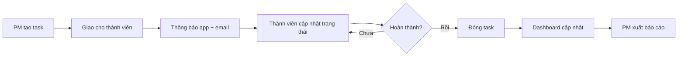
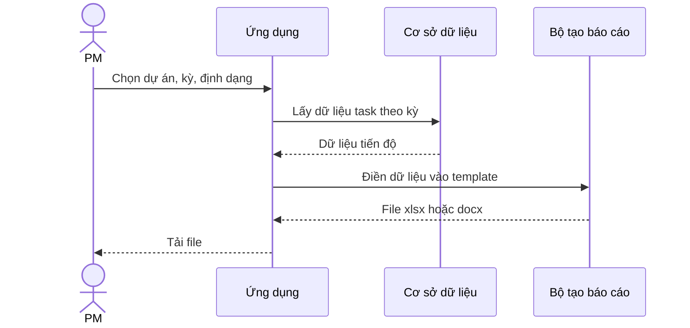

# Phân tích nghiệp vụ: Quản lý Dự án CNTT

Ngày: 2026-11-13 · Pha 2 · Trạng thái: Đã duyệt lại (2026-11-13, gồm điều chỉnh theo OpenProject ở mục 10)
Nguồn: [requirements.md](../01-discovery/requirements.md). Mục đánh dấu **[CẦN XÁC NHẬN]** là chỗ chưa rõ, chưa tự điền; xem mục 8.

## 1. Actor và hệ thống ngoài
| Actor | Mô tả | Quyền chính |
|---|---|---|
| Admin | Quản trị hệ thống | Quản lý người dùng, vai trò, cấu hình; mọi quyền của PM |
| PM | Quản lý dự án, người dùng chính | Tạo và quản lý dự án, giao việc, xuất báo cáo |
| Thành viên | Dev, team kỹ thuật | Xem và cập nhật task được giao, tạo task trong dự án mình tham gia |
| Người xem | Ban lãnh đạo, khách hàng nội bộ | Chỉ xem dự án, dashboard |

| Hệ thống ngoài | Vai trò |
|---|---|
| Dịch vụ gửi email | Gửi thông báo giao việc, nhắc hạn |
| Nhà cung cấp đăng nhập Google | Đăng nhập bằng tài khoản Google |
| Template báo cáo Word/Excel của công ty | Khuôn mẫu cho báo cáo xuất ra (chưa có, R-005) |

## 2. Use case
| Mã | Tên | Actor | Điều kiện đầu | Luồng chính | Luồng thay thế | Kết quả |
|---|---|---|---|---|---|---|
| UC-01 | Đăng nhập | Mọi actor | Có tài khoản | Nhập email, mật khẩu hoặc chọn Google, vào hệ thống | Sai mật khẩu: báo lỗi; tài khoản bị khóa: từ chối | Phiên đăng nhập, giao diện theo vai trò |
| UC-02 | Quản lý người dùng và vai trò | Admin | Đã đăng nhập | Mời người dùng, gán vai trò, khóa/mở tài khoản | Email đã tồn tại: báo trùng | Người dùng có vai trò hợp lệ |
| UC-03 | Tạo và quản lý dự án | PM, Admin | Đã đăng nhập | Tạo dự án (tên, mô tả, ngày bắt đầu/kết thúc), thêm thành viên, chọn trạng thái dự án | Tên trùng: cho phép nhưng cảnh báo | Dự án có danh sách thành viên |
| UC-04 | Tạo dự án từ template | PM | Có template dự án | Chọn template, nhập tên, hệ thống nhân bản cấu trúc | Template rỗng: tạo dự án trống | Dự án mới có cấu trúc sẵn |
| UC-05 | Quản lý task | PM, Thành viên | Là thành viên dự án | Tạo task (tên, mô tả, người phụ trách, hạn, ưu tiên, nhãn, trạng thái), tạo subtask, sửa, xóa | Thiếu tên: từ chối; sửa task người khác: theo BR-03 | Task lưu, ghi nhật ký, gửi thông báo |
| UC-06 | Xem Kanban và danh sách | Mọi actor có quyền xem | Dự án có task | Chuyển giữa Kanban và danh sách; kéo thả task đổi trạng thái | Người xem kéo thả: bị chặn | Trạng thái cập nhật, ghi nhật ký |
| UC-07 | Tìm kiếm và lọc | Mọi actor | Đã đăng nhập | Nhập từ khóa, lọc theo người phụ trách, trạng thái, ưu tiên, nhãn, hạn | Không có kết quả: hiển thị trống | Danh sách task khớp điều kiện |
| UC-08 | Quản lý phụ thuộc task | PM, Thành viên | Có ít nhất 2 task | Đặt task A bị chặn bởi task B | Tạo vòng phụ thuộc: từ chối (BR-05) | Quan hệ phụ thuộc hiển thị trên task |
| UC-09 | Nhận thông báo | Mọi actor | Có sự kiện (giao việc, nhắc hạn, đổi trạng thái) | Hệ thống tạo thông báo trong app, gửi email | Gửi email lỗi: thử lại, ghi nhật ký | Người dùng thấy thông báo |
| UC-10 | Xem dashboard tiến độ | PM, Người xem, Admin | Dự án có task | Mở dashboard: % hoàn thành, task trễ hạn, phân bố theo trạng thái và người phụ trách | Dự án chưa có task: hiển thị trống | Số liệu tiến độ |
| UC-11 | Xuất báo cáo tiến độ | PM, Admin | Có template báo cáo | Chọn dự án, kỳ báo cáo, định dạng (xlsx hoặc docx), tải file | Thiếu template: báo lỗi; dữ liệu quá lớn: báo thời gian chờ | File báo cáo theo template |
| UC-12 | Xem nhật ký hoạt động | PM, Admin | Đã đăng nhập | Mở nhật ký của dự án hoặc task, lọc theo người, thời gian | | Danh sách thay đổi |
| UC-13 | Đổi ngôn ngữ | Mọi actor | Đã đăng nhập | Chọn Tiếng Việt hoặc English | | Giao diện đổi ngôn ngữ, ghi nhớ lựa chọn |

## 3. Quy trình chính
Vòng đời task:

Xuất báo cáo:

## 4. Yêu cầu chức năng (FR)
| Mã | Yêu cầu | Use case |
|---|---|---|
| FR-01 | Đăng nhập bằng email và mật khẩu, và bằng Google | UC-01 |
| FR-02 | Admin mời người dùng, gán Phòng ban (một phòng ban mỗi người, danh mục do Admin quản lý), khóa/mở tài khoản, cấp quyền Admin; danh sách người dùng hiển thị Phòng ban và lọc theo Phòng ban (sếp yêu cầu 2026-11-13); PM của dự án gán vai trò (PM, Thành viên, Người xem) cho thành viên dự án đó | UC-02 |
| FR-03 | Tạo, sửa, lưu trữ dự án; quản lý thành viên dự án | UC-03 |
| FR-04 | Tạo dự án từ template dự án; lưu dự án hiện có thành template | UC-04 |
| FR-05 | Tạo, sửa, xóa task với tên, mô tả, người phụ trách, hạn chót, mức ưu tiên | UC-05 |
| FR-06 | Gắn nhãn; cấu hình trạng thái task tùy chỉnh theo dự án | UC-05 |
| FR-07 | Tạo subtask tối đa 3 cấp (đã chốt 2026-11-13) theo quy tắc BR-04 | UC-05 |
| FR-08 | Xem task dạng Kanban (kéo thả) và dạng danh sách | UC-06 |
| FR-09 | Tìm kiếm theo từ khóa; lọc theo người phụ trách, trạng thái, ưu tiên, nhãn, hạn | UC-07 |
| FR-10 | Đặt quan hệ "bị chặn bởi" giữa các task, chặn vòng phụ thuộc | UC-08 |
| FR-11 | Thông báo trong app khi được giao việc, task đổi trạng thái, sắp đến hạn | UC-09 |
| FR-12 | Gửi email cho giao việc và nhắc hạn; người dùng bật/tắt từng loại | UC-09 |
| FR-13 | Dashboard: % hoàn thành, số task trễ hạn, phân bố theo trạng thái và người phụ trách | UC-10 |
| FR-14 | Xuất báo cáo tiến độ ra .xlsx theo template công ty | UC-11 |
| FR-15 | Xuất báo cáo tiến độ ra .docx theo template công ty | UC-11 |
| FR-16 | Ghi nhật ký mọi thay đổi dự án, task (ai, khi nào, trước và sau); xem và lọc | UC-12 |
| FR-17 | Giao diện tiếng Việt và English; nhớ lựa chọn của người dùng | UC-13 |
| FR-18 | Giao diện dùng được trên điện thoại (responsive) | UC-05, UC-06, UC-10 |

## 5. Quy tắc nghiệp vụ (BR)
| Mã | Quy tắc |
|---|---|
| BR-01 | (Sửa 2026-11-13) Admin là quyền toàn hệ thống. Trong mỗi dự án, người dùng có đúng 1 vai trò: PM, Thành viên hoặc Người xem; một người có thể có vai trò khác nhau ở các dự án khác nhau (như OpenProject). Người không phải Admin và chưa thuộc dự án thì không thấy dự án đó |
| BR-02 | Người xem chỉ đọc; không tạo, sửa, xóa, kéo thả, xuất báo cáo |
| BR-03 | Thành viên sửa được task mình phụ trách và task do mình tạo; PM và Admin sửa được mọi task trong dự án; Thành viên không sửa task của người khác (đã chốt 2026-11-13) |
| BR-04 | Không đóng task cha khi còn subtask chưa hoàn thành |
| BR-05 | Phụ thuộc giữa các task không được tạo vòng (A chặn B, B chặn A) |
| BR-06 | Task bị chặn bởi task chưa xong vẫn được chuyển sang "Hoàn thành" nhưng hệ thống hiển thị cảnh báo (đã chốt 2026-11-13: cảnh báo, không chặn cứng) |
| BR-07 | Chỉ PM và Admin được xuất báo cáo và tạo template dự án |
| BR-08 | Báo cáo luôn dùng đúng template công ty; người dùng không tự sửa cấu trúc template trong app |
| BR-09 | Nhật ký hoạt động không được sửa hoặc xóa qua giao diện |
| BR-10 | Chỉ thành viên của dự án (và Admin) thấy dự án đó |
| BR-11 | Xóa task, dự án cần xác nhận; MVP xóa vĩnh viễn vì thùng rác để đợt sau (R-007) |

## 6. Yêu cầu phi chức năng (NFR)
Chỉ số có đánh dấu "đề xuất" do mình tính từ cỡ dự án (dưới 100 người), sếp có thể chỉnh. Chỉ số "đã chốt" lấy từ câu trả lời khảo sát.

| Mã | Loại | Yêu cầu | Chỉ số đo | Nguồn |
|---|---|---|---|---|
| NFR-01 | Hiệu năng | Trang danh sách, Kanban, dashboard tải nhanh | Thời gian tải trang dưới 2 giây ở bách phân vị 95 | Đã chốt (C3) |
| NFR-02 | Hiệu năng | API phản hồi nhanh với thao tác thường gặp | P95 dưới 500 ms với dự án 2.000 task | Đề xuất |
| NFR-03 | Hiệu năng | Xuất báo cáo | Dưới 30 giây cho dự án 2.000 task | Đề xuất |
| NFR-04 | Sẵn sàng | Hoạt động giờ hành chính | Uptime khoảng 99% trong 7h-19h ngày làm việc; chấp nhận bảo trì ngắn | Đã chốt (C3) |
| NFR-05 | Sao lưu | Khôi phục dữ liệu khi sự cố | RPO 24 giờ, RTO 4 giờ **[CẦN XÁC NHẬN]** | Đề xuất |
| NFR-06 | Bảo mật | Xác thực và phân quyền | Mọi API kiểm tra vai trò phía máy chủ; có kiểm thử phân quyền cho 4 vai trò | Đề xuất |
| NFR-07 | Bảo mật | Bảo vệ dữ liệu khi truyền và lưu | TLS 1.2 trở lên; mật khẩu băm bằng thuật toán hiện đại; không lưu bí mật trong repo | Đề xuất |
| NFR-08 | Bảo mật | Phụ thuộc và bí mật | CI quét bí mật và lỗ hổng phụ thuộc, lỗi mức cao chặn merge | Đề xuất |
| NFR-09 | Mở rộng | Quy mô người dùng | 100 người dùng, 30 người đồng thời, không phải đổi kiến trúc | Đã chốt (A2) cho 100 người; 30 đồng thời đề xuất |
| NFR-10 | Khả dụng | Dùng được trên điện thoại | Hiển thị đúng từ chiều rộng 360 px | Đã chốt (A3) |
| NFR-11 | Đa ngôn ngữ | Việt và English | 100% chuỗi giao diện qua file ngôn ngữ; không có chuỗi gõ cứng | Đã chốt (A5) |
| NFR-12 | Chi phí | Hạ tầng | Dưới 25 USD mỗi tháng | Đã chốt (D1) |
| NFR-13 | Bảo trì | Chất lượng mã | TypeScript chế độ nghiêm ngặt, lint và test chạy trong CI, độ phủ test mục tiêu ở Pha 3 | Đề xuất |
| NFR-14 | Tuân thủ | Dữ liệu cá nhân nhân sự | Chỉ lưu tên, email, phòng ban, vai trò; rà soát theo quy định về dữ liệu cá nhân khi vào vận hành **[CẦN XÁC NHẬN]** | C1, C2 chưa hỏi |

## 7. Ma trận truy vết
Cột Story điền ở Pha 4, cột Test điền ở Pha 5.

| Yêu cầu | Epic | Story | Test |
|---|---|---|---|
| FR-01, FR-02, BR-01, BR-02, BR-10, NFR-06 | E1 Nền tảng, đăng nhập, RBAC (QLDA-12) | E1-1, E1-3, E1-2, E1-4, E1-5, E1-6, E1-7 | |
| FR-05, FR-06, FR-07, BR-03, BR-04, BR-11 | E2 Dự án và task cốt lõi (QLDA-13) | E2-1, E2-2, E2-3, E2-4, E2-6, E2-5, E2-7 | |
| FR-03 | E2 Dự án và task cốt lõi (QLDA-13) | E2-1, E2-2, E2-3, E2-4, E2-6, E2-5, E2-7 | |
| FR-08, FR-09 | E3 Chế độ xem và tìm kiếm (QLDA-14) | E3-1, E3-3, E3-2, E3-4 | |
| FR-11, FR-12 | E4 Thông báo (QLDA-15) | E4-1, E4-2, E4-3 | |
| FR-13, FR-14, FR-15, BR-07, BR-08, NFR-03 | E5 Dashboard và báo cáo (QLDA-16) | E5-1, E5-2, E5-3, E5-4, E5-5 | |
| FR-16, BR-09 | E6 Nhật ký hoạt động (QLDA-17) | E6-1, E6-2 | |
| FR-04 | E7 Template dự án (QLDA-18) | E7-1 | |
| FR-10, BR-05, BR-06 | E8 Phụ thuộc giữa các task (QLDA-19) | E8-1, E8-2, E8-3 | |
| FR-17, FR-18, NFR-10, NFR-11 | E10 Đa ngôn ngữ và responsive (QLDA-20) | E10-1, E10-2, E10-3 | |
| NFR-01, NFR-02, NFR-04, NFR-05, NFR-07, NFR-08, NFR-09, NFR-12, NFR-13, NFR-14 | Xuyên suốt (kiểm ở Pha 3, 5, 6) | | |

## 8. Chỗ chưa rõ, cần sếp xác nhận
Đã chốt ngày 2026-11-13: subtask tối đa 3 cấp (FR-07); Thành viên chỉ sửa task mình phụ trách hoặc tạo (BR-03); task bị chặn chỉ cảnh báo, vẫn cho hoàn thành (BR-06).

Còn mở:
1. Mục tiêu khôi phục dữ liệu: mất tối đa bao nhiêu dữ liệu (RPO) và bao lâu phải chạy lại (RTO)? (NFR-05)
2. Dữ liệu nhân sự có chịu quy định bảo vệ dữ liệu cá nhân nào cần tuân thủ không? (NFR-14)
3. Nhắc hạn gửi trước bao lâu (ví dụ 1 ngày, 3 ngày)? (FR-11, FR-12)
4. Template báo cáo: file mẫu .docx và .xlsx hiện dùng, các trường cần điền. (R-005)

## 10. Điều chỉnh ngày 2026-11-13 theo OpenProject (cần duyệt lại)
Nguồn: sếp yêu cầu giống OpenProject về thuật ngữ và chức năng, giữ giao diện v1; tài liệu chính thức của OpenProject (xem [work-package-views](https://www.openproject.org/docs/user-guide/work-packages/work-package-views/), [gantt-chart](https://www.openproject.org/docs/user-guide/gantt-chart/), [relations-hierarchies](https://www.openproject.org/docs/user-guide/work-packages/work-package-relations-hierarchies/), [exporting](https://www.openproject.org/docs/user-guide/work-packages/exporting/)); tra ngày 2026-11-13, chưa kiểm chứng trên bản OpenProject team đang dùng.

### 10.1 Use case mới hoặc đổi
| Mã | Tên | Actor | Mô tả ngắn |
|---|---|---|---|
| UC-08 (đổi) | Quản lý quan hệ giữa task | PM, Thành viên | Đặt quan hệ: liên quan, chặn/bị chặn bởi, đứng trước/đứng sau, trùng lặp (kiểu vào MVP: **[CẦN XÁC NHẬN]**) |
| UC-14 | Quản lý chế độ xem đã lưu | Mọi vai trò | Lưu bộ lọc, sắp xếp, nhóm, cột thành chế độ xem riêng, công khai hoặc yêu thích; dùng chế độ xem mặc định (Tất cả đang mở, Hoạt động gần nhất, Mới tạo, Quá hạn, Tóm tắt, Tạo bởi tôi, Giao cho tôi) |
| UC-15 | Xem và lập lịch trên Gantt (đợt sau, ngoài MVP từ gate Pha 4) | PM, Thành viên (xem: Người xem) | Xem task theo thời gian, kéo chỉnh ngày bắt đầu và kết thúc, thấy quan hệ đứng trước/đứng sau |
| UC-16 | Xem bảng phân cấp | Mọi vai trò | Bảng có thu gọn/mở rộng cha-con, nhóm theo thuộc tính, chọn cột |

### 10.2 Yêu cầu chức năng mới hoặc đổi
| Mã | Yêu cầu | Use case |
|---|---|---|
| FR-10 (đổi) | Nhiều kiểu quan hệ giữa task; chặn vòng cho quan hệ có thứ tự (chặn, đứng trước) | UC-08 |
| FR-19 | Chế độ xem đã lưu (riêng, công khai, yêu thích) và các chế độ xem mặc định | UC-14 |
| FR-20 | Gantt: hiển thị task theo ngày bắt đầu và kết thúc, kéo chỉnh ngày, hiển thị quan hệ, thu phóng | UC-15 |
| FR-21 | Task có ngày bắt đầu, ngày kết thúc (thay cho chỉ có hạn); quy tắc lập lịch tự động hay thủ công **[CẦN XÁC NHẬN]** | UC-15 |
| FR-22 | Bảng phân cấp thu gọn/mở rộng, nhóm theo thuộc tính, chọn và sắp xếp cột | UC-16 |
| FR-23 | Loại task (ví dụ Task, Bug, Milestone, Phase) như loại work package của OpenProject **[CẦN XÁC NHẬN]** | UC-05 |

### 10.3 Quy tắc nghiệp vụ đổi
- BR-01 sửa như mục 5: vai trò theo từng dự án.
- BR-12 (mới): chế độ xem công khai chỉ thấy task mà người xem đủ quyền xem (không lộ task của dự án khác).
- BR-13 (mới): task có ngày kết thúc không được sớm hơn ngày bắt đầu; task "đứng sau" không bắt đầu trước ngày kết thúc của task "đứng trước" (cảnh báo hay chặn theo quyết định ở FR-21).

### 10.4 Yêu cầu phi chức năng thêm (đề xuất)
| Mã | Yêu cầu | Chỉ số |
|---|---|---|
| NFR-15 | Gantt tải nhanh | Dự án 500 task hiển thị dưới 2 giây ở P95 (đề xuất) |
| NFR-16 | Bảng phân cấp và chế độ xem đã lưu | Áp dụng bộ lọc và nhóm trên 2.000 task dưới 1 giây phản hồi API (đề xuất) |

### 10.5 Truy vết bổ sung
| Yêu cầu | Epic |
|---|---|
| FR-10, BR-05, BR-06 | E8 Quan hệ giữa các task (QLDA-19, đổi tên) |
| FR-19, BR-12 | E13 Chế độ xem đã lưu (mới) |
| FR-20, FR-21, BR-13, NFR-15 | E12 Timeline/Gantt (QLDA-23, vào MVP) |
| FR-22, NFR-16 | E3 Chế độ xem và tìm kiếm (QLDA-14) |
| FR-23 | E2 Dự án và task cốt lõi (QLDA-13) |
| FR-02, BR-01 (sửa) | E1 Nền tảng, đăng nhập, RBAC (QLDA-12) |

### 10.6 Thuật ngữ OpenProject cần chốt (chưa tự điền)
Các từ cần thống nhất giữa tiếng Việt và tiếng Anh với team: Work package (task), Type (loại), Status (trạng thái), Priority (ưu tiên), Assignee (người thực hiện), Version (phiên bản), View (chế độ xem), Relation (quan hệ), Parent/Child (cha/con), Follows/Precedes (đứng sau/đứng trước), Blocks/Blocked by (chặn/bị chặn bởi). Cách gọi chính thức: **[CẦN XÁC NHẬN]** với team đang dùng OpenProject (tiếng Anh hay tiếng Việt).

### 10.7 Thông tin cần từ sếp
Ảnh chụp các màn OpenProject team dùng nhiều nhất, danh sách module đang bật, phiên bản OpenProject và gói (Community hay Enterprise), vì mình chưa vào được hệ thống của team.

## 11. Rủi ro mới ở Pha 2 và sau điều chỉnh OpenProject
Đã ghi vào `PROJECT_STATE.md`: R-007 (MVP xóa vĩnh viễn vì thùng rác để đợt sau), R-009 (quy mô giống OpenProject so với 6 đến 8 tuần), R-008 (giá và giới hạn gói dịch vụ đổi theo thời gian, số liệu trong ma trận stack chưa xác minh từ trang chính thức).
