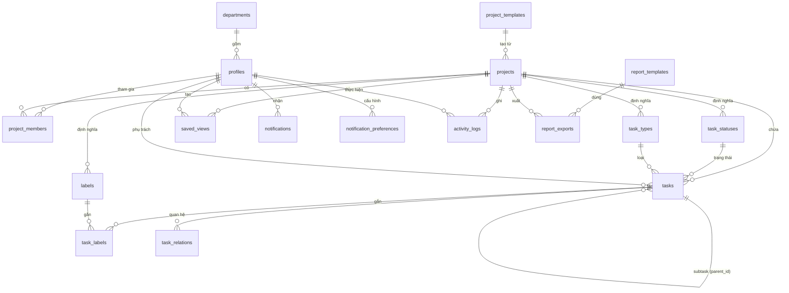

# Thiết kế cơ sở dữ liệu

Ngày: 2026-11-13 · Pha 3 · Trạng thái: Chờ duyệt (phần 2: DB và API)
Quy ước: bảng `snake_case` số nhiều, cột `snake_case`, khóa chính `id uuid`, thời gian `timestamptz` (`created_at`, `updated_at`). Postgres chuẩn trên Supabase (ADR-001), không dùng tính năng khó chuyển đi.

## 1. ERD

## 2. Từ điển dữ liệu
| Bảng | Cột chính | Ghi chú |
|---|---|---|
| `departments` | `id`, `name`, `position` | Phòng ban, danh mục do Admin quản lý (yêu cầu 2026-11-13) |
| `profiles` | `id` (= `auth.users.id`), `full_name`, `email`, `department_id`, `is_admin`, `locale` (`vi`/`en`), `is_active` | `is_admin` là quyền toàn hệ thống (BR-01 sửa 2026-11-13); vai trò nằm ở `project_members`. Chỉ họ tên, email, số điện thoại, phòng ban (NFR-14); `phone` do chính người dùng nhập, PM và Admin xem được |
| `profile_contacts` | `user_id` (PK, → `profiles`), `phone`, `updated_at` | Số điện thoại tách khỏi `profiles` vì RLS lọc theo hàng (E1-3, PR 14); chỉ chính chủ, PM của dự án chung và Admin đọc; chỉ chính chủ ghi; định dạng `^\+?[0-9][0-9 .()-]{5,19}$` |
| `projects` | `id`, `name`, `description`, `start_date`, `end_date`, `status` (`active`/`archived`), `created_by`, `template_id` | FR-03 |
| `project_members` | `project_id`, `user_id`, `role` (`pm`/`member`/`viewer`), `joined_at` | Khóa chính (`project_id`, `user_id`); vai trò theo từng dự án (BR-01), quyết định ai thấy dự án (BR-10) |
| `task_types` | `id`, `project_id`, `name`, `is_milestone`, `color`, `position` | Loại task (FR-23); mặc định Task, Bug, Milestone, Phase **[CẦN XÁC NHẬN]** |
| `saved_views` | `id`, `project_id` (null nếu toàn cục), `owner_id`, `name`, `query jsonb` (bộ lọc, sắp xếp, nhóm, cột, chế độ hiển thị), `visibility` (`private`/`public`), `is_favorite` | Chế độ xem đã lưu (FR-19); chế độ xem mặc định tạo bằng seed, không sửa được |
| `task_statuses` | `id`, `project_id`, `name`, `category` (`todo`/`in_progress`/`done`), `position` | Trạng thái tùy chỉnh (FR-06); `category` để tính tiến độ |
| `labels` | `id`, `project_id`, `name`, `color` | FR-06 |
| `tasks` | `id`, `project_id`, `parent_id`, `depth` (1-3), `type_id`, `title`, `description`, `assignee_id`, `created_by`, `priority` (`low`/`medium`/`high`/`urgent`), `start_date`, `due_date`, `status_id`, `position`, `completed_at` | `depth` ≤ 3 (FR-07); `start_date` ≤ `due_date` (BR-13); hai ngày cho Gantt (FR-20, FR-21) |
| `task_labels` | `task_id`, `label_id` | Nhiều nhiều |
| `task_relations` | `id`, `from_task_id`, `to_task_id`, `kind` (`relates`/`blocks`/`precedes`/`duplicates`), `lag_days` | Thay `task_dependencies`; quan hệ đảo (bị chặn bởi, đứng sau, bị trùng) suy ra từ `kind`. Không vòng cho `blocks`, `precedes` (BR-05); không tự quan hệ với chính mình. Kiểu vào MVP **[CẦN XÁC NHẬN]** |
| `notifications` | `id`, `user_id`, `type`, `task_id`, `payload jsonb`, `read_at`, `created_at` | FR-11 |
| `notification_preferences` | `user_id`, `type`, `email_enabled` | FR-12 |
| `activity_logs` | `id`, `project_id`, `actor_id`, `entity_type`, `entity_id`, `action`, `changes jsonb` (trước, sau), `created_at` | Chỉ INSERT (BR-09) |
| `project_templates` | `id`, `name`, `structure jsonb` (trạng thái, nhãn, cây task), `created_by` | FR-04 |
| `report_templates` | `id`, `kind` (`xlsx`/`docx`), `name`, `storage_path`, `uploaded_by`, `is_active` | Template công ty (BR-08); tệp ở Storage |
| `report_exports` | `id`, `project_id`, `template_id`, `format`, `period_start`, `period_end`, `requested_by`, `created_at` | Ghi ai xuất báo cáo nào |

## 3. Ràng buộc và trigger
- `tasks.depth`: trigger đặt `depth = parent.depth + 1`; từ chối nếu vượt 3.
- `task_relations`: trigger từ chối vòng với `blocks` và `precedes` (BR-05) bằng truy vấn đệ quy.
- `tasks`: kiểm tra `start_date` ≤ `due_date` (BR-13); quy tắc dời ngày task "đứng sau" khi task "đứng trước" đổi ngày phụ thuộc quyết định lập lịch tự động hay thủ công (FR-21, **[CẦN XÁC NHẬN]**).
- BR-04: trigger chặn đặt task cha thuộc trạng thái `done` khi còn subtask chưa `done`.
- `tasks.status_id` phải thuộc đúng `project_id` của task.
- BR-06: không chặn cứng; cảnh báo xử lý ở tầng ứng dụng, đọc từ `task_relations` (kind `blocks`).

## 4. Chỉ mục
| Chỉ mục | Phục vụ |
|---|---|
| `tasks (project_id, status_id, position)` | Kanban |
| `tasks (project_id, assignee_id)` | Lọc theo người phụ trách |
| `tasks (project_id, due_date)` | Nhắc hạn, trễ hạn |
| `tasks (project_id, start_date, due_date)` | Gantt theo khoảng thời gian |
| `task_relations (from_task_id)`, `(to_task_id)` | Tìm quan hệ hai chiều |
| `saved_views (project_id, owner_id)` | Danh sách chế độ xem |
| `tasks (parent_id)` | Subtask |
| `tasks` GIN trên `to_tsvector('simple', title \|\| ' ' \|\| coalesce(description,''))` | Tìm kiếm (FR-09); cấu hình tiếng Việt cần kiểm chứng, **[CẦN XÁC NHẬN]** cách xử lý dấu |
| `activity_logs (project_id, created_at desc)` | Xem nhật ký |
| `notifications (user_id, read_at, created_at desc)` | Chuông thông báo |
| `project_members (user_id)` | Danh sách dự án của một người |

## 5. Phân quyền hàng (RLS)
Các cột Người xem, Thành viên, PM là vai trò **trong dự án** (`project_members.role`); Admin là `profiles.is_admin` (BR-01 sửa 2026-11-13). Người không thuộc dự án và không phải Admin không thấy dòng nào của dự án đó.
| Bảng | Người xem | Thành viên | PM | Admin |
|---|---|---|---|---|
| `projects` | Đọc dự án mình thuộc | Đọc dự án mình thuộc | Đọc, sửa (kể cả lưu trữ) dự án mình là PM; tạo mới nếu là PM ở ít nhất một dự án; KHÔNG xóa (sếp chốt 2026-11-13) | Toàn quyền, chỉ Admin xóa |
| `project_members` | Đọc cùng dự án | Đọc cùng dự án; không tự nâng vai trò | Thêm, đổi vai trò, gỡ thành viên dự án mình là PM | Toàn quyền |
| `departments` | Đọc | Đọc | Đọc | Đọc, ghi |
| `profile_contacts` | Chỉ của mình | Chỉ của mình | Của mình và thành viên dự án mình là PM | Đọc tất cả; ghi chỉ của mình |
| `tasks` | Đọc | Đọc; sửa task mình phụ trách hoặc tạo (BR-03); tạo task | Đọc, sửa mọi task trong dự án | Toàn quyền |
| `activity_logs` | Không | Không | Đọc nhật ký dự án mình thuộc | Đọc tất cả |
| `saved_views` | Đọc chế độ xem công khai; tạo, sửa chế độ xem riêng của mình | Giống Người xem | Giống Thành viên; sửa chế độ xem công khai của dự án | Toàn quyền |
| `task_relations` | Đọc | Tạo, xóa khi có quyền sửa cả hai task | Toàn quyền trong dự án | Toàn quyền |
| `profiles` | Đọc mình và người cùng dự án | Giống Người xem; sửa `full_name`, `locale` của mình | **Đọc mọi hồ sơ** (sếp chấp nhận 2026-11-13, để tìm người thêm vào dự án) | Đọc tất cả; đổi `is_admin`, `is_active`, phòng ban qua API máy chủ (khóa service) |
| `report_templates` | Không | Không | Đọc | Toàn quyền |
| `notifications` | Chỉ của mình | Chỉ của mình | Chỉ của mình | Chỉ của mình |
Người dùng bị khóa (`is_active = false`) không có quyền gì, kể cả đọc hồ sơ của mình. Hàm hỗ trợ RLS là SECURITY DEFINER trong schema `private` (không phơi qua API). `INSERT ... RETURNING` trên `projects` bị từ chối với PM không phải Admin (policy SELECT chạy trước trigger thêm PM): dùng `public.create_project()` hoặc client tự sinh `id` và đọc lại. Chưa chặn gỡ PM cuối cùng của dự án (trigger để Story sau). Mỗi migration thêm bảng mới phải tự `revoke` quyền mặc định của Supabase rồi `grant` theo cột. `activity_logs` không có chính sách UPDATE/DELETE cho bất kỳ vai trò nào. Mọi chính sách có kiểm thử riêng (xem [test-strategy.md](test-strategy.md)).

## 6. Migration
- Mỗi thay đổi là một tệp SQL trong `supabase/migrations/` (đặt tên theo thời gian), chạy được từ đầu trên CSDL trống.
- Không sửa migration đã merge; thay đổi mới là migration mới.
- Seed dữ liệu giả ở `supabase/seed.sql`, không dữ liệu thật (repo công khai).
- Trước khi chạy migration ở production phải qua staging và có bản sao lưu (NFR-05).

## 7. Lưu trữ và xóa dữ liệu
- MVP xóa task, dự án vĩnh viễn (BR-11, R-007); xóa dự án xóa theo task, nhãn, trạng thái, thành viên (`ON DELETE CASCADE`). Nhật ký của dự án bị xóa vẫn giữ được hay không: **[CẦN XÁC NHẬN]**.
- Người dùng bị khóa: giữ hồ sơ (`is_active = false`), không xóa để giữ lịch sử.
- Thời gian lưu nhật ký và thông báo: **[CẦN XÁC NHẬN]** (đề xuất nhật ký 24 tháng, thông báo đã đọc 90 ngày).
- Sao lưu: RPO 24 giờ, RTO 4 giờ là đề xuất (NFR-05, chưa xác nhận); chính sách sao lưu của từng gói Supabase chưa xác minh từ trang chính thức, cần kiểm tra trước khi vận hành thật (R-008).
