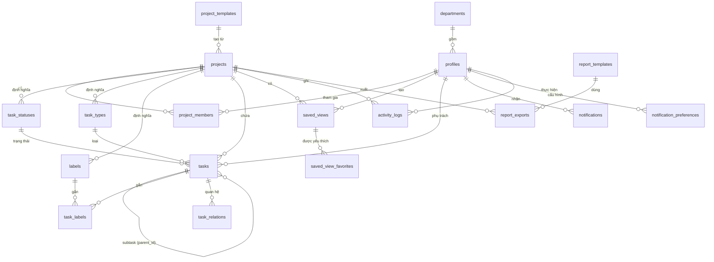

# Thiết kế cơ sở dữ liệu

Ngày: 2026-11-13 · Pha 3 · Trạng thái: Chờ duyệt (phần 2: DB và API)
Quy ước: bảng `snake_case` số nhiều, cột `snake_case`, khóa chính `id uuid`, thời gian `timestamptz` (`created_at`, `updated_at`). Postgres chuẩn trên Supabase (ADR-001), không dùng tính năng khó chuyển đi.

## 1. ERD

## 2. Từ điển dữ liệu
| Bảng | Cột chính | Ghi chú |
|---|---|---|
| `departments` | `id`, `name`, `position`, `archived_at` | Phòng ban, danh mục do Admin quản lý (yêu cầu 2026-11-13). Tên duy nhất không phân biệt hoa thường (`departments_name_ci_key`); lưu trữ thay vì xóa, chỉ xóa cứng được phòng ban không còn ai (RLS + `private.department_has_members`) |
| `profiles` | `id` (= `auth.users.id`), `full_name`, `email`, `department_id`, `is_admin`, `locale` (`vi`/`en`), `is_active` | `is_admin` là quyền toàn hệ thống (BR-01 sửa 2026-11-13); vai trò nằm ở `project_members`. Chỉ họ tên, email, số điện thoại, phòng ban (NFR-14); `phone` do chính người dùng nhập, PM và Admin xem được |
| `profile_contacts` | `user_id` (PK, → `profiles`), `phone`, `updated_at` | Số điện thoại tách khỏi `profiles` vì RLS lọc theo hàng (E1-3, PR 14); chỉ chính chủ, PM của dự án chung và Admin đọc; chỉ chính chủ ghi; định dạng `^\+?[0-9][0-9 .()-]{5,19}$` |
| `projects` | `id`, `name`, `description`, `start_date`, `end_date`, `status` (`active`/`archived`), `created_by`, `template_id` | FR-03 |
| `project_members` | `project_id`, `user_id`, `role` (`pm`/`member`/`viewer`), `joined_at` | Khóa chính (`project_id`, `user_id`); vai trò theo từng dự án (BR-01), quyết định ai thấy dự án (BR-10). E1-6 (PR 34, `20261115200000`): trigger `guard_last_pm` không cho gỡ hoặc hạ PM đang hoạt động cuối cùng (kể cả Admin và service_role; ngoại lệ chỉ khi xóa dự án hoặc xóa hẳn tài khoản; khóa dòng dự án chống đua). Hàm `public.set_project_member(project, user, role)` (INVOKER, kiểm quyền trước, người đích phải đang hoạt động) và `public.search_users_for_membership(q, exclude_project_id, limit)` (INVOKER; PM của ≥1 dự án hoặc Admin; trả id, họ tên, email, phòng ban; tối đa 20). Khóa tài khoản (E1-4) chưa chặn khi người đó là PM hoạt động cuối của một dự án |
| `task_types` | `id`, `project_id`, `name`, `is_milestone`, `color`, `position`, `created_at`, `updated_at` | Loại task (FR-23); mặc định Task, Bug, Milestone (`is_milestone`), Phase (sếp chốt 2026-11-15). Tên duy nhất trong dự án không phân biệt hoa thường; màu `#RRGGBB`; `position` là số thực. E2-3 (PR 30) |
| `saved_views` | `id`, `project_id` (null chỉ với chế độ xem mặc định), `owner_id` (null với mặc định), `name` (1..100, duy nhất theo `(project_id, owner_id, lower(btrim(name)))`), `query jsonb`, `visibility` (`private`/`public`), `is_default`, `created_at`, `updated_at` | Chế độ xem đã lưu (FR-19), E13-1 (PR 35, `20261115210000`). Chỉ lưu CÁCH XEM (BR-12), không lưu danh sách task: `query = {version: 1, filters, sort, group_by, columns, display}`, CHECK `private.saved_view_query_is_valid` (đủ 6 khóa, khóa lạ bị từ chối, ≤ 8 KB; bộ lọc kiểm bằng chính `validateTaskListQuery` ở tầng API); id lọc chỉ kiểm định dạng lúc lưu, thuộc dự án hay không kiểm lúc dùng. Trigger `guard_saved_view_identity`: `project_id`, `owner_id`, `is_default` không đổi được. Chế độ xem mặc định (`is_default`, do hệ thống tạo, E13-2 seed) không sửa, xóa được |
| `saved_view_favorites` | `view_id`, `user_id` | Yêu thích của từng người (thay cột `is_favorite` trong bản đầu: cột không đúng được với chế độ xem công khai); chỉ đánh dấu được chế độ xem mình đọc được |
| `task_statuses` | `id`, `project_id`, `name`, `category` (enum `task_status_category`: `todo`/`in_progress`/`done`), `color`, `position`, `created_at`, `updated_at` | Trạng thái tùy chỉnh (FR-06); `category` để tính tiến độ và đặt `completed_at`. Mặc định theo OpenProject (sếp chốt 2026-11-15): Mới (todo), Đang thực hiện, Đang kiểm thử, Cần phản hồi (in_progress), Đã xong, Đã đóng, Từ chối (done). Danh sách mặc định nằm duy nhất trong `private.seed_project_defaults()` (trigger AFTER INSERT trên `projects`, migration backfill dự án có sẵn). E2-3 |
| `labels` | `id`, `project_id`, `name`, `color`, `created_at`, `updated_at` | FR-06; tên duy nhất trong dự án không phân biệt hoa thường |
| `tasks` | `id`, `project_id`, `parent_id`, `depth` (1-3), `type_id`, `title`, `description`, `assignee_id`, `created_by`, `priority` (`low`/`medium`/`high`/`urgent`), `start_date`, `due_date`, `status_id`, `position`, `completed_at` | `depth` ≤ 3 (FR-07); `start_date` ≤ `due_date` (BR-13); hai ngày cho Gantt (FR-20, FR-21). Đã tạo ở E2-2 (`20261114090000_tasks.sql`): `position` là `double precision` (kéo thả chèn giữa không đánh số lại); `parent_id`/`depth` có cột nhưng chưa có trigger (E2-4 đang làm). E2-3 (`20261115130000`): `status_id`, `type_id` NOT NULL (backfill), **khóa ngoại kép** `(project_id, status_id) → task_statuses (project_id, id)` và tương tự cho loại (khai báo, không bỏ sót đường ghi nào, Postgres chặn xóa trạng thái đang dùng); trigger `apply_task_config` chỉ thêm mặc định (trạng thái todo đầu tiên, loại đầu tiên); `completed_at` do trigger đặt theo nhóm `done` của trạng thái (trình duyệt không có quyền cột này); quyền cột trình duyệt thêm INSERT/UPDATE `type_id`, `status_id`. E2-1: `projects` có ràng buộc `description` ≤ 5000 ký tự, chỉ mục `projects_status_created_idx`, hàm `public.project_stats(uuid[], date)` (SECURITY INVOKER nên RLS vẫn áp dụng; số thành viên, số task, số task đã xong theo `completed_at`, số task trễ hạn, vai trò của người gọi; hiệu năng chưa đo); trigger `check_assignee`: người được giao phải là PM hoặc Thành viên đang hoạt động của dự án; quyền cột cho trình duyệt chỉ gồm `project_id` (khi tạo), `title`, `description`, `assignee_id`, `priority`, `start_date`, `due_date`, `position` |
| `task_labels` | `task_id`, `label_id` | Nhiều nhiều; nhãn phải cùng dự án với task (trigger `check_task_label_project`); hàm `public.set_task_labels()` thay toàn bộ nhãn của task |
| `task_relations` | `id`, `from_task_id`, `to_task_id`, `kind` (enum `task_relation_kind`: `relates`/`blocks`/`precedes`/`duplicates`), `lag_days` (±365, chỉ cho `precedes`, còn lại phải bằng 0), `created_by`, `created_at` | E8-1 (PR 29). Thay `task_dependencies`; quan hệ đảo (bị chặn bởi, đứng sau, bị trùng) suy ra từ `kind`. CHECK không tự quan hệ; UNIQUE (from, to, kind); `relates` đối xứng nhờ chỉ mục duy nhất trên `(least, greatest)`; hai khóa ngoại `ON DELETE CASCADE`. Cả 4 kiểu vào MVP. Không có UPDATE (xóa rồi tạo lại) |
| `notifications` | `id`, `user_id`, `type`, `task_id`, `payload jsonb`, `read_at`, `created_at` | FR-11 |
| `notification_preferences` | `user_id`, `type`, `email_enabled` | FR-12 |
| `activity_logs` | `id`, `project_id`, `actor_id`, `entity_type`, `entity_id`, `action`, `changes jsonb` (trước, sau), `created_at` | Chỉ INSERT (BR-09). E6-1 (PR 28): ghi bằng trigger AFTER (`private.log_activity()`) trên `projects`, `project_members`, `tasks`; UPDATE, DELETE, TRUNCATE bị chặn bằng trigger kể cả `service_role`; không khóa ngoại (nhật ký sống lâu hơn dòng được ghi); `actor_id` null khi thao tác bằng service role; `entity_type` chỉ nhận project, project_member, task (nhật ký quan hệ, nhãn, cấu hình chưa có); chỉ PM của dự án và Admin đọc được |
| `project_templates` | `id`, `name`, `structure jsonb` (trạng thái, nhãn, cây task), `created_by` | FR-04 |
| `report_templates` | `id`, `kind` (`xlsx`/`docx`), `name`, `storage_path`, `uploaded_by`, `is_active` | Template công ty (BR-08); tệp ở Storage |
| `report_exports` | `id`, `project_id`, `template_id`, `format`, `period_start`, `period_end`, `requested_by`, `created_at` | Ghi ai xuất báo cáo nào |

## 3. Ràng buộc và trigger
- Cây subtask (E2-4, PR 33, `20261115190000`): `tasks.depth` lưu sẵn; trigger `check_task_tree` (BEFORE) đặt `depth = depth cha + 1`, `cascade_subtask_depth` (AFTER) cập nhật con cháu khi đổi cha; trình duyệt ghi được `parent_id` nhưng không ghi được `depth`. Thứ tự kiểm khi tạo/đổi cha (mọi đường ghi): người ngoài dự án (42501, chống dò) → cha tồn tại và cùng dự án (chung một lỗi `parent_not_in_project`) → người dùng cuối phải sửa được task cha (`parent_not_editable`) → không tự làm cha, không vòng (`task_parent_cycle`) → tối đa 3 cấp kể cả chiều cao cây con (`subtask_depth_exceeded`). Đồng thời: khóa tư vấn toàn cục cho cấu trúc cây (UPDATE đổi cha lấy khóa độc quyền ở trigger mức câu lệnh, INSERT lấy khóa chia sẻ); thử bỏ khóa thì 36/40 lượt đua tạo vòng thật. **BR-04**: trigger AFTER UPDATE OF `status_id` `check_parent_close`: đưa task vào nhóm done thì mọi hậu duệ (mọi cấp) phải ở nhóm done (Đã đóng, Từ chối tính là xong); lỗi `parent_has_open_subtasks` kèm tối đa 5 id; khóa FOR SHARE hậu duệ để đóng cha đồng thời với mở lại con không lọt. Chỉ chặn hành động đóng cha: mở lại con khi cha đã done, thêm con chưa xong dưới cha đã done không bị chặn (cha giữ done). PM đổi nhóm trạng thái sang done làm một cha thành done khi còn con chưa xong: bị chặn (`check_category_close`). Quyết định mới: tạo con hoặc chuyển task vào dưới P đòi quyền sửa P (vì gắn con sẽ chặn đóng P). Xóa task cha vẫn xóa dây chuyền mọi hậu duệ (`ON DELETE CASCADE` từ E2-2, **chưa quyết định đổi**).
- `task_relations` (E8-1): trigger `check_task_relation` (BEFORE INSERT/UPDATE, SECURITY DEFINER) theo thứ tự: (1) người dùng cuối phải sửa được **cả hai** task (42501, để lỗi "vòng" hay "khác dự án" không dò được task người gọi không thấy); (2) cùng dự án (`task_relation_cross_project` → 422); (3) chống vòng (BR-05, `task_relation_cycle` → 409) bằng CTE đệ quy. `blocks` và `precedes` dùng **chung một đồ thị** (cả hai nghĩa "from đi trước to"), `relates` và `duplicates` không tính; khóa tư vấn `pg_advisory_xact_lock` theo dự án để hai yêu cầu đồng thời không tạo vòng. Đường hệ thống (`auth.uid()` null) vẫn qua kiểm cùng dự án và chống vòng. Đo: chuỗi 1.000 cạnh, kiểm cạnh đóng vòng dài nhất 0,85 ms.
- `private.can_read_task(uuid)`, `private.can_edit_task(uuid)`: định nghĩa **giống hệt** ở hai migration (E2-3 `20261115130000` và E8-1 `20261115170000`, `create or replace`), phải trùng điều kiện RLS `tasks_select`/`tasks_update`; sửa một bên phải sửa cả bên kia (pgTAP so với UPDATE thật cho 8 persona).
- E2-3: mỗi dự án luôn còn ≥1 trạng thái todo, ≥1 done, ≥1 loại task (trigger khóa dòng dự án để chống đua; xóa dự án thì bỏ qua). `public.delete_task_status()`/`delete_task_type()` (SECURITY INVOKER): có `p_replace_with` thì chuyển task rồi xóa cùng giao dịch, không có mà đang dùng thì `status_in_use`. Đổi `category` của trạng thái cập nhật `completed_at` của các task trong đó (`private.sync_tasks_on_status_category()`, SECURITY DEFINER, chỉ chạy khi RLS đã cho PM/Admin sửa trạng thái).
- `tasks`: kiểm tra `start_date` ≤ `due_date` (BR-13); quy tắc dời ngày task "đứng sau" khi task "đứng trước" đổi ngày phụ thuộc quyết định lập lịch tự động hay thủ công (FR-21, **[CẦN XÁC NHẬN]**).
- BR-04: xem mục cây subtask ở trên (đã làm, E2-4).
- `tasks.status_id`, `tasks.type_id` phải thuộc đúng `project_id` của task: đảm bảo bằng khóa ngoại kép (E2-3), không bằng trigger.
- BR-06: không chặn cứng; cảnh báo xử lý ở tầng ứng dụng, đọc từ `task_relations` (kind `blocks`).

## 4. Chỉ mục
| Chỉ mục | Phục vụ |
|---|---|
| `tasks (project_id, status_id, position)` | Kanban |
| `tasks (project_id, assignee_id)` | Lọc theo người phụ trách |
| `tasks (project_id, due_date)` | Nhắc hạn, trễ hạn |
| `tasks (project_id, start_date, due_date)` | Gantt theo khoảng thời gian |
| `task_relations (from_task_id)`, `(to_task_id)` | Tìm quan hệ hai chiều |
| `saved_views (project_id, owner_id)` | Danh sách chế độ xem |
| `tasks (parent_id)` | Subtask |
| `tasks_search_trgm_idx`: GIN `pg_trgm` trên `private.task_search_text(title, description)` | Tìm kiếm FR-09 (E3-3, PR 32, `20261115180000`); **chốt 2026-11-15: tìm bỏ dấu** bằng `unaccent`, không phân biệt hoa thường, không fuzzy, mọi từ khóa phải có (AND). `private.search_normalize` IMMUTABLE bọc `unaccent` với từ điển ghi rõ schema; không dùng tsvector (chỉ khớp theo từ) và không thêm cột sinh (trigger `activity_logs` ghi `to_jsonb(new)` sẽ log cả cột đó). `private.search_task_ids` (SECURITY DEFINER, chỉ trả id khi người gọi thấy dự án, để dùng được chỉ mục dưới RLS: toán tử LIKE không LEAKPROOF) và `public.search_tasks` (INVOKER, RLS quyết định cuối). Đo 5.000 task: từ 160 ms xuống 2,5 đến 40 ms |
| `saved_views (project_id, owner_id, lower(btrim(name)))` duy nhất; `saved_views (owner_id)`; `saved_view_favorites (user_id)` | Danh sách chế độ xem, yêu thích (E13-1) |
| `projects (status, created_at desc)` (`projects_status_created_idx`) | Danh sách dự án (E2-1) |
| `activity_logs (project_id, created_at desc)`, `(entity_type, entity_id, created_at desc)` | Xem nhật ký dự án, lịch sử một đối tượng (E6-1) |
| `notifications (user_id, read_at, created_at desc)` | Chuông thông báo |
| `project_members (user_id)` | Danh sách dự án của một người |

## 5. Phân quyền hàng (RLS)
Các cột Người xem, Thành viên, PM là vai trò **trong dự án** (`project_members.role`); Admin là `profiles.is_admin` (BR-01 sửa 2026-11-13). Người không thuộc dự án và không phải Admin không thấy dòng nào của dự án đó.
| Bảng | Người xem | Thành viên | PM | Admin |
|---|---|---|---|---|
| `projects` | Đọc dự án mình thuộc | Đọc dự án mình thuộc | Đọc, sửa (kể cả lưu trữ) dự án mình là PM; tạo mới nếu là PM ở ít nhất một dự án; KHÔNG xóa (sếp chốt 2026-11-13) | Toàn quyền, chỉ Admin xóa |
| `project_members` | Đọc cùng dự án | Đọc cùng dự án; không tự nâng vai trò | Thêm, đổi vai trò, gỡ thành viên dự án mình là PM (không gỡ, không hạ PM hoạt động cuối) | Toàn quyền (cũng không gỡ PM cuối) |
| `departments` | Đọc | Đọc | Đọc | Đọc, ghi |
| `profile_contacts` | Chỉ của mình | Chỉ của mình | Của mình và thành viên dự án mình là PM | Đọc tất cả; ghi chỉ của mình |
| `tasks` | Đọc | Đọc; sửa task mình phụ trách hoặc tạo (BR-03); tạo task; xóa task mình tạo. Thành viên chỉ phụ trách (không tạo) không giao task đi cho người khác được (WITH CHECK = USING) | Đọc, sửa, xóa mọi task trong dự án | Toàn quyền |
| `activity_logs` | Không | Không | Đọc nhật ký dự án mình thuộc | Đọc tất cả |
| `saved_views` | Đọc chế độ xem công khai và riêng của mình; tạo, sửa, xóa chế độ xem riêng của mình | Giống Người xem | Giống Thành viên; tạo, sửa, xóa chế độ xem công khai của dự án (kể cả của PM khác); chỉ chủ sở hữu được đổi công khai về riêng tư | Giống PM; không đọc chế độ xem riêng tư của người khác (404). Chế độ xem mặc định: không ai sửa, xóa |
| `saved_view_favorites` | Chỉ dấu của mình, trên chế độ xem đọc được | Giống | Giống | Giống |
| `task_relations` | Đọc khi thấy cả hai task | Tạo, xóa khi sửa được cả hai task (`private.can_edit_task`); không có UPDATE | Giống Thành viên (sửa được mọi task trong dự án) | Toàn quyền |
| `task_statuses`, `task_types`, `labels` | Đọc | Đọc | Đọc, thêm, sửa, xóa (dự án mình là PM) | Toàn quyền |
| `task_labels` | Đọc theo quyền đọc task | Gắn, gỡ khi sửa được task (BR-03) | Gắn, gỡ mọi task trong dự án | Toàn quyền |
| `profiles` | Đọc mình và người cùng dự án | Giống Người xem; sửa `full_name`, `locale` của mình | **Đọc mọi hồ sơ** (sếp chấp nhận 2026-11-13, để tìm người thêm vào dự án) | Đọc tất cả; đổi `is_admin`, `is_active`, phòng ban qua API máy chủ (khóa service) |
| `report_templates` | Không | Không | Đọc | Toàn quyền |
| `notifications` | Chỉ của mình | Chỉ của mình | Chỉ của mình | Chỉ của mình |
Hai hàm quản trị `admin_list_users` và `admin_update_user` (SECURITY DEFINER, `search_path = ''`, chỉ `service_role` gọi được; migration `20261113150000_admin_users.sql`): khóa hàng mọi Admin đang hoạt động trước khi kiểm quy tắc để số Admin không về 0 khi hai Admin thao tác cùng lúc. Người dùng bị khóa (`is_active = false`) không có quyền gì, kể cả đọc hồ sơ của mình. Hàm hỗ trợ RLS là SECURITY DEFINER trong schema `private` (không phơi qua API). `INSERT ... RETURNING` trên `projects` bị từ chối với PM không phải Admin (policy SELECT chạy trước trigger thêm PM): dùng `public.create_project()` hoặc client tự sinh `id` và đọc lại. Chưa chặn gỡ PM cuối cùng của dự án (trigger để Story sau). Mỗi migration thêm bảng mới phải tự `revoke` quyền mặc định của Supabase rồi `grant` theo cột. `activity_logs` không có chính sách UPDATE/DELETE cho bất kỳ vai trò nào. Mọi chính sách có kiểm thử riêng (xem [test-strategy.md](test-strategy.md)).

Bộ đếm giới hạn tần suất (E0-5): `private.rate_limit_counters` (RLS bật, không chính sách, khóa đã băm HMAC) và hàm `private.rate_limit_hit` qua wrapper `public.rate_limit_hit`, chỉ `service_role` gọi được; tự dọn dòng hết hạn.

## 6. Migration
- Mỗi thay đổi là một tệp SQL trong `supabase/migrations/` (đặt tên theo thời gian), chạy được từ đầu trên CSDL trống.
- Không sửa migration đã merge; thay đổi mới là migration mới.
- Seed dữ liệu giả ở `supabase/seed.sql`, không dữ liệu thật (repo công khai).
- Trước khi chạy migration ở production phải qua staging và có bản sao lưu (NFR-05).

## 7. Lưu trữ và xóa dữ liệu
- MVP xóa task, dự án vĩnh viễn (BR-11, R-007); xóa dự án xóa theo task, nhãn, trạng thái, thành viên (`ON DELETE CASCADE`). Nhật ký của dự án bị xóa vẫn giữ được hay không: **[CẦN XÁC NHẬN]**.
- Người dùng bị khóa: giữ hồ sơ (`is_active = false`), không xóa để giữ lịch sử.
- Thời gian lưu nhật ký và thông báo: **[CẦN XÁC NHẬN]** (đề xuất nhật ký 24 tháng, thông báo đã đọc 90 ngày).
- Sao lưu: RPO 24 giờ, RTO 4 giờ là đề xuất (NFR-05, chưa xác nhận); chính sách sao lưu của từng gói Supabase chưa xác minh từ trang chính thức, cần kiểm tra trước khi vận hành thật (R-008).
