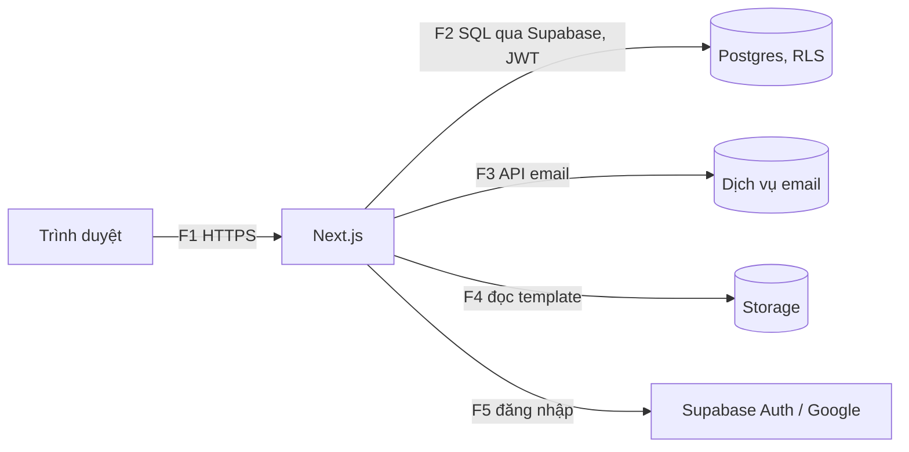

# Bảo mật và threat model

Ngày: 2026-11-13 · Pha 3 · Trạng thái: Chờ duyệt (phần 1: kiến trúc và bảo mật)
Liên quan: NFR-06, NFR-07, NFR-08, NFR-14, R-002.

## 1. Tài sản và dữ liệu
| Dữ liệu | Mức độ | Ghi chú |
|---|---|---|
| Họ tên, email, số điện thoại, phòng ban, vai trò người dùng | Dữ liệu cá nhân nhân sự | Chỉ lưu những trường này (NFR-14); số điện thoại chỉ PM và Admin xem được, Người xem không thấy |
| Nội dung dự án, task | Nội bộ thông thường (C1) | Chưa có tài chính, y tế |
| Template báo cáo | Nội bộ | Lưu ở Supabase Storage, chỉ Admin tải lên |
| Khóa dịch vụ (`service_role`, API email) | Rất nhạy | Không bao giờ vào repo công khai |

## 2. Ranh giới tin cậy và luồng dữ liệu

## 3. STRIDE theo luồng
| Luồng | Mối đe dọa | Biện pháp |
|---|---|---|
| F1 | **S**poofing: chiếm phiên đăng nhập | Cookie httpOnly, Secure, SameSite=Lax; hết hạn phiên; đăng nhập Google/mật khẩu qua Supabase Auth |
| F1 | **T**ampering: sửa dữ liệu gửi lên, CSRF | Kiểm tra đầu vào bằng schema phía máy chủ (không tin giao diện); Route Handler thay đổi dữ liệu bắt buộc header `Origin` trùng origin của yêu cầu, `Content-Type: application/json` và giới hạn kích thước thân (đã có ở API quản trị; E0-5 gom thành tiện ích dùng chung; Server Action do Next.js kiểm Origin). **[CẦN XÁC NHẬN]** đúng khi chạy sau proxy Vercel |
| F1 | **I**nformation disclosure: XSS đọc dữ liệu | React escape mặc định; không dùng `dangerouslySetInnerHTML` với nội dung người dùng; CSP chặt (E0-5: nonce theo từng yêu cầu, `strict-dynamic`, không `unsafe-eval` ở production; `style-src` còn `unsafe-inline` vì thuộc tính `style` của React; root layout render động nên mất static shell/PPR; thêm `X-Content-Type-Options`, `Referrer-Policy`, `Permissions-Policy`, `frame-ancestors 'none'`, HSTS ở production); mô tả task là văn bản thuần (E2-5: hiển thị qua nút văn bản React với `white-space: pre-wrap`, không render HTML hay Markdown; có e2e kiểm `<b>` hiện nguyên văn) |
| F1 | **D**oS: gọi API liên tục, xuất báo cáo nặng | Giới hạn tần suất theo người dùng và IP (E0-5, ngưỡng ở [api-contract.md](api-contract.md) mục 5; IP chỉ tin header khi chạy trên Vercel); đăng nhập fail-closed khi bộ đếm lỗi, nên thiếu `SUPABASE_SERVICE_ROLE_KEY` thì không đăng nhập được; giới hạn theo email có thể bị lợi dụng khóa tạm một tài khoản (chấp nhận); giới hạn kỳ và kích thước báo cáo; thời gian chờ tối đa |
| F2 | **E**levation of privilege: người xem sửa dữ liệu, thành viên xem dự án không thuộc về mình, dùng vai trò của dự án này ở dự án khác | RLS cho từng bảng theo vai trò trong dự án (`project_members.role`), `is_admin` và tư cách thành viên (BR-01, BR-02, BR-03, BR-10); kiểm thử phân quyền tự động trong CI (NFR-06), gồm ca người có vai trò khác nhau ở hai dự án |
| F2 | **I**nformation disclosure: chế độ xem công khai lộ task của dự án khác | Chế độ xem công khai chỉ trả task người xem đủ quyền (BR-12), lọc theo RLS chứ không theo truy vấn đã lưu |
| F2 | **T**ampering: sửa hoặc xóa nhật ký | `activity_logs` chỉ cho phép INSERT, không UPDATE/DELETE qua RLS (BR-09) |
| F3 | **I**nformation disclosure: lộ khóa email, nội dung thông báo | Khóa chỉ ở biến môi trường máy chủ; thông báo email chỉ chứa tên task và liên kết, không chứa mô tả dài |
| F4 | **T**ampering: tải template độc hại | Chỉ Admin tải lên (BR-08); kiểm tra loại và kích thước tệp; xử lý template ở máy chủ, không thực thi macro. Với template docx (E5-4, PR 67) rủi ro lớn hơn vì docx-templates mặc định chạy JavaScript trong template bằng `node:vm` (không phải ranh giới bảo mật): đã chặn bằng ba lớp (duyệt trước mọi lệnh bằng whitelist: chỉ ô giữ chỗ dạng đường dẫn khóa và `FOR`/`END-FOR`, còn lại từ chối cả template; thay bộ chạy JS bằng bộ tra khóa trên đối tượng không prototype, chặn `__proto__`/`constructor`/`prototype`; dấu chèn XML thô ngẫu nhiên mỗi lần xuất), có 18 mẫu template độc hại trong test |

| F5 | **S**poofing: đăng nhập giả mạo | Chỉ nhà cung cấp đã cấu hình; xác minh redirect URL; mời người dùng bằng email; chặn đăng ký tự do ở Auth bằng `enable_signup = false` (E1-2, PR 17), tài khoản Google chỉ gắn vào người đã được mời, email lạ bị từ chối; link mời không tiêu thụ token khi chỉ mở trang (xác minh trong Server Action, E1-8), mật khẩu tối thiểu 12 ký tự, giới hạn tần suất theo IP |
| Chung | **R**epudiation: chối bỏ thao tác | Nhật ký hoạt động ghi người làm, thời gian, trước và sau (FR-16) |

## 4. Quản lý bí mật (repo công khai)
- Không commit bí mật: gitleaks quét toàn lịch sử trong CI và `.gitignore` chặn `.env*` (trừ `.env.example`).
- Khóa `service_role` chỉ ở Vercel/GitHub Secrets, dùng phía máy chủ. Mã dùng khóa nằm ở `lib/supabase/admin.ts` (đọc biến không tiền tố `NEXT_PUBLIC_`, chặn chạy ở trình duyệt, không lưu phiên); `make build` kèm kiểm `.next/static` không chứa `service_role`. Trong API quản trị, quyền người gọi được kiểm bằng client phiên (qua RLS) trước khi tạo client service_role.
- Nếu lộ khóa: thu hồi và tạo lại ngay, rồi ghi sự cố vào `PROJECT_STATE.md`. GitHub secret scanning và push protection bật cho repo (**[CẦN XÁC NHẬN]**: sếp bật tay ở Settings → Code security, chưa xác nhận). Biến `RATE_LIMIT_SECRET` (chuỗi ngẫu nhiên riêng, tùy chọn) dùng băm khóa bộ đếm.

## 5. Bảo vệ dữ liệu cá nhân (C1, C2, NFR-14)
- Nguyên tắc tối thiểu: chỉ lưu họ tên, email, số điện thoại, phòng ban, vai trò, ngôn ngữ ưa thích.
- Người dùng bị khóa vẫn giữ lịch sử (nhật ký không xóa), không còn đăng nhập được.
- **[CẦN XÁC NHẬN]** Quy định bảo vệ dữ liệu cá nhân cần tuân thủ và thời gian lưu nhật ký; chưa hỏi ở Pha 1 (C2). Mình không tự điền điều khoản pháp lý.

## 6. Kiểm tra và giám sát
- CI chặn merge khi có bí mật hoặc lỗ hổng phụ thuộc mức high (NFR-08, đã có).
- Kiểm thử phân quyền cho 4 vai trò ở mọi bảng trước khi vào Pha 5 hoàn tất (xem [test-strategy.md](test-strategy.md)).
- Xem lại threat model khi thêm tính năng đợt sau (tệp đính kèm, bình luận, tích hợp).

## 7. Phụ thuộc và chuỗi cung ứng
- `make security` chạy `pnpm audit --audit-level high`; cảnh báo high hoặc critical làm CI đỏ (NFR-08).
- Ngoại lệ chỉ được thêm khi có quyết định rõ ràng, phải có hạn rà lại, và chỉ liệt kê đúng mã GHSA trong `auditConfig.ignoreGhsas` của `pnpm-workspace.yaml` (pnpm 12 đọc cấu hình ở đây).

| Advisory | Gói | Lý do bỏ qua | Quyết định | Rà lại trước |
|---|---|---|---|---|
| [GHSA-fc5q-39xc-vjpf](https://github.com/advisories/GHSA-fc5q-39xc-vjpf) | picomatch <= 4.0.7 (ReDoS qua extglob lặp một nhánh, mức high, chưa có bản vá) | Chỉ có trong công cụ phát triển (eslint-config-next, vitest/vite/tinyglobby, ...), không chạy ở production. Đã kiểm: `pnpm why picomatch --prod` trống, `pnpm audit --prod --audit-level high` không có lỗ hổng. | 2026-11-18 | 2026-12-18 |

Khi rà lại: nếu đã có bản vá thì nâng phụ thuộc và xoá ngoại lệ; nếu picomatch xuất hiện trong `pnpm why picomatch --prod` thì xoá ngoại lệ ngay.
