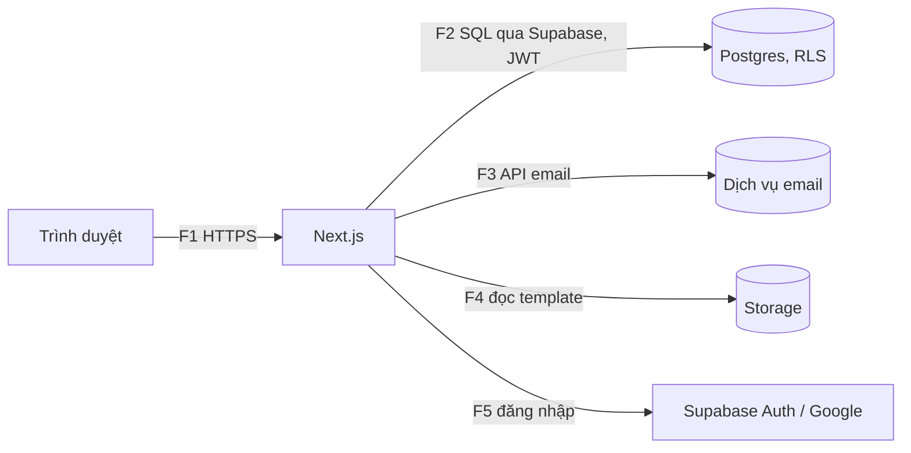

# Bảo mật và threat model

Ngày: 2026-11-13 · Pha 3 · Trạng thái: Chờ duyệt (phần 1: kiến trúc và bảo mật)
Liên quan: NFR-06, NFR-07, NFR-08, NFR-14, R-002.

## 1. Tài sản và dữ liệu
| Dữ liệu | Mức độ | Ghi chú |
|---|---|---|
| Họ tên, email, vai trò người dùng | Dữ liệu cá nhân nhân sự | Chỉ lưu những trường này (NFR-14) |
| Nội dung dự án, task | Nội bộ thông thường (C1) | Chưa có tài chính, y tế |
| Template báo cáo | Nội bộ | Lưu ở Supabase Storage, chỉ Admin tải lên |
| Khóa dịch vụ (`service_role`, API email) | Rất nhạy | Không bao giờ vào repo công khai |

## 2. Ranh giới tin cậy và luồng dữ liệu

## 3. STRIDE theo luồng
| Luồng | Mối đe dọa | Biện pháp |
|---|---|---|
| F1 | **S**poofing: chiếm phiên đăng nhập | Cookie httpOnly, Secure, SameSite=Lax; hết hạn phiên; đăng nhập Google/mật khẩu qua Supabase Auth |
| F1 | **T**ampering: sửa dữ liệu gửi lên, CSRF | Kiểm tra đầu vào bằng schema phía máy chủ (không tin giao diện); Route Handler thay đổi dữ liệu kiểm tra origin và token CSRF |
| F1 | **I**nformation disclosure: XSS đọc dữ liệu | React escape mặc định; không dùng `dangerouslySetInnerHTML` với nội dung người dùng; CSP chặt; mô tả task dạng văn bản thuần hoặc Markdown được làm sạch |
| F1 | **D**oS: gọi API liên tục, xuất báo cáo nặng | Giới hạn tần suất theo người dùng và IP; giới hạn kỳ và kích thước báo cáo; thời gian chờ tối đa |
| F2 | **E**levation of privilege: người xem sửa dữ liệu, thành viên xem dự án không thuộc về mình, dùng vai trò của dự án này ở dự án khác | RLS cho từng bảng theo vai trò trong dự án (`project_members.role`), `is_admin` và tư cách thành viên (BR-01, BR-02, BR-03, BR-10); kiểm thử phân quyền tự động trong CI (NFR-06), gồm ca người có vai trò khác nhau ở hai dự án |
| F2 | **I**nformation disclosure: chế độ xem công khai lộ task của dự án khác | Chế độ xem công khai chỉ trả task người xem đủ quyền (BR-12), lọc theo RLS chứ không theo truy vấn đã lưu |
| F2 | **T**ampering: sửa hoặc xóa nhật ký | `activity_logs` chỉ cho phép INSERT, không UPDATE/DELETE qua RLS (BR-09) |
| F3 | **I**nformation disclosure: lộ khóa email, nội dung thông báo | Khóa chỉ ở biến môi trường máy chủ; thông báo email chỉ chứa tên task và liên kết, không chứa mô tả dài |
| F4 | **T**ampering: tải template độc hại | Chỉ Admin tải lên (BR-08); kiểm tra loại và kích thước tệp; xử lý template ở máy chủ, không thực thi macro |
| F5 | **S**poofing: đăng nhập giả mạo | Chỉ nhà cung cấp đã cấu hình; xác minh redirect URL; mời người dùng bằng email (không đăng ký tự do, **[CẦN XÁC NHẬN]**) |
| Chung | **R**epudiation: chối bỏ thao tác | Nhật ký hoạt động ghi người làm, thời gian, trước và sau (FR-16) |

## 4. Quản lý bí mật (repo công khai)
- Không commit bí mật: gitleaks quét toàn lịch sử trong CI và `.gitignore` chặn `.env*` (trừ `.env.example`).
- Khóa `service_role` chỉ ở Vercel/GitHub Secrets, dùng phía máy chủ.
- Nếu lộ khóa: thu hồi và tạo lại ngay, rồi ghi sự cố vào `PROJECT_STATE.md`. GitHub secret scanning bật cho repo (**[CẦN XÁC NHẬN]**: kiểm tra đã bật chưa).

## 5. Bảo vệ dữ liệu cá nhân (C1, C2, NFR-14)
- Nguyên tắc tối thiểu: chỉ lưu họ tên, email, vai trò, ngôn ngữ ưa thích.
- Người dùng bị khóa vẫn giữ lịch sử (nhật ký không xóa), không còn đăng nhập được.
- **[CẦN XÁC NHẬN]** Quy định bảo vệ dữ liệu cá nhân cần tuân thủ và thời gian lưu nhật ký; chưa hỏi ở Pha 1 (C2). Mình không tự điền điều khoản pháp lý.

## 6. Kiểm tra và giám sát
- CI chặn merge khi có bí mật hoặc lỗ hổng phụ thuộc mức high (NFR-08, đã có).
- Kiểm thử phân quyền cho 4 vai trò ở mọi bảng trước khi vào Pha 5 hoàn tất (xem [test-strategy.md](test-strategy.md)).
- Xem lại threat model khi thêm tính năng đợt sau (tệp đính kèm, bình luận, tích hợp).
