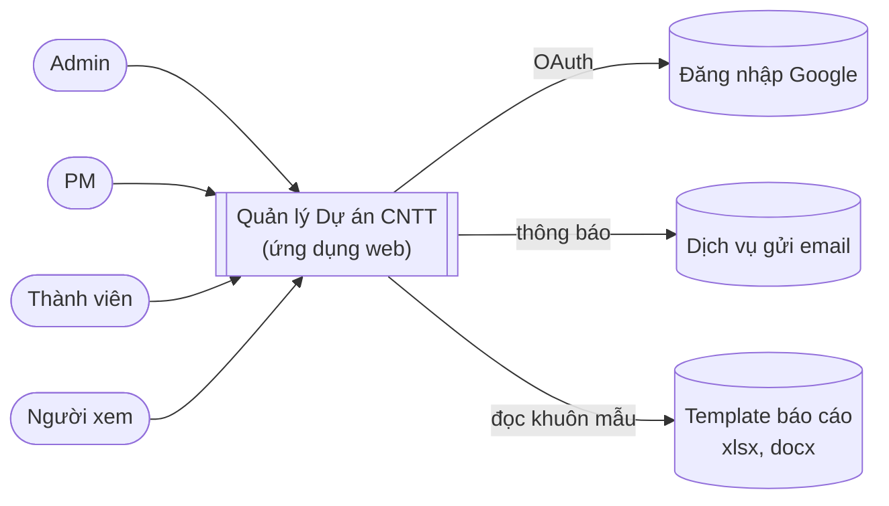
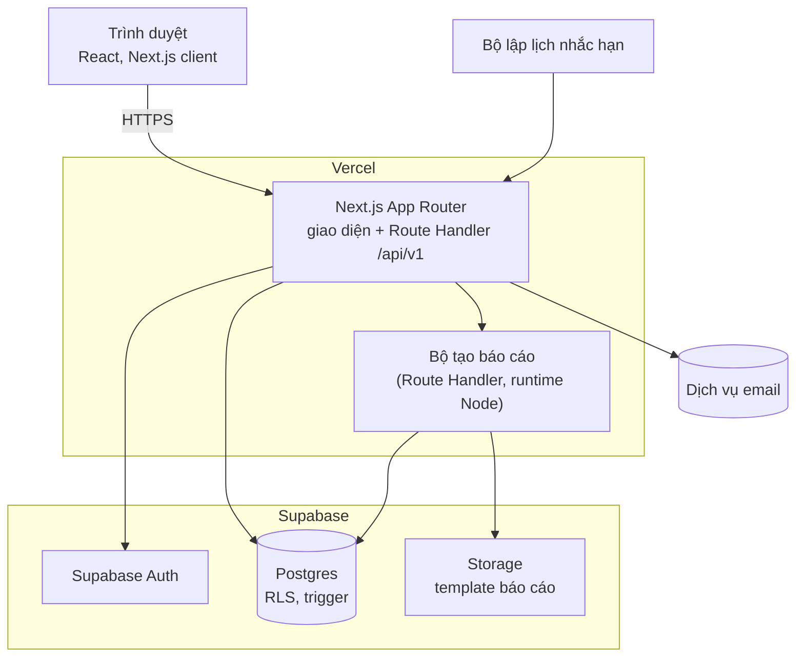
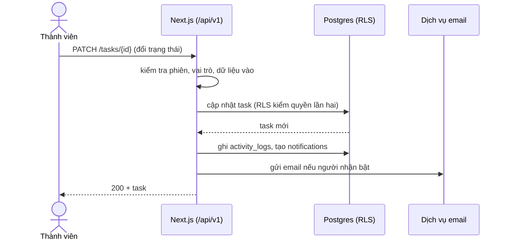

# Thiết kế hệ thống

Ngày: 2026-11-13 · Pha 3 · Trạng thái: Chờ duyệt (phần 1: kiến trúc và bảo mật)
Nguồn: [business-analysis.md](../02-ba/business-analysis.md), [ADR-001](../adr/ADR-001-tech-stack.md). Mục **[CẦN XÁC NHẬN]** chưa được sếp chốt.

## 1. Ngữ cảnh hệ thống (C4 mức 1)

## 2. Container (C4 mức 2)

## 3. Thành phần theo Epic
| Thành phần | Trách nhiệm | Epic |
|---|---|---|
| `auth` | Phiên đăng nhập, vai trò, mời người dùng | E1 |
| `projects`, `tasks` | Dự án, task, subtask (tối đa 3 cấp), nhãn, trạng thái | E2 |
| `views`, `search` | Kanban, danh sách, tìm kiếm, bộ lọc | E3 |
| `notifications` | Thông báo trong app, email, nhắc hạn | E4 |
| `dashboard`, `reports` | Số liệu tiến độ, xuất xlsx/docx | E5 |
| `activity` | Nhật ký thay đổi | E6 |
| `templates` | Template dự án | E7 |
| `dependencies` | Phụ thuộc giữa task, cảnh báo task bị chặn | E8 |
| `i18n`, `ui` | Việt/English, responsive, design system | E10 |

Quy tắc: logic nghiệp vụ nằm ở lớp `lib/` thuần TypeScript (dễ kiểm thử); Route Handler chỉ kiểm tra đầu vào, gọi lớp nghiệp vụ, trả kết quả.

## 4. Luồng dữ liệu chính

## 5. Xác thực và phân quyền
- Đăng nhập email/mật khẩu và Google qua Supabase Auth; phiên lưu bằng cookie httpOnly (thư viện `@supabase/ssr`).
- Vai trò toàn hệ thống nằm ở `profiles.role` (BR-01): `admin`, `pm`, `member`, `viewer`. Quyền trong dự án qua `project_members` (BR-10).
- Hai lớp kiểm quyền: (1) Route Handler kiểm vai trò theo [api-contract.md](api-contract.md); (2) RLS ở Postgres (phòng thủ chiều sâu, NFR-06). Không bao giờ chỉ tin kiểm tra ở giao diện.
- Khóa `service_role` chỉ dùng phía máy chủ cho tác vụ quản trị (mời người dùng), không đưa ra trình duyệt, không commit (repo công khai).

## 6. Xử lý lỗi
- API trả cấu trúc lỗi thống nhất (xem [api-contract.md](api-contract.md)); không lộ chi tiết nội bộ.
- Giao diện có trạng thái rỗng, đang tải, lỗi cho mọi danh sách và trang (xem [ui-ux](ui-ux/)).
- Gửi email lỗi: thử lại tối đa 3 lần, vẫn lỗi thì ghi log, không làm hỏng thao tác chính (UC-09).
- Xuất báo cáo quá thời gian: trả lỗi rõ ràng, gợi ý thu hẹp kỳ báo cáo (R-006).

## 7. Logging và giám sát
- Log có cấu trúc (JSON) phía Next.js, kèm mã yêu cầu; không ghi mật khẩu, token, nội dung task nhạy cảm.
- Nhật ký hoạt động nghiệp vụ nằm ở bảng `activity_logs` (khác log kỹ thuật).
- Giám sát uptime và theo dõi lỗi: **[CẦN XÁC NHẬN]** công cụ (cần chọn gói miễn phí để giữ dưới 25 USD/tháng, NFR-12). Mục tiêu: cảnh báo khi uptime giờ hành chính dưới 99% (NFR-04).

## 8. Môi trường
| Môi trường | Next.js | Supabase | Dữ liệu |
|---|---|---|---|
| Local | `pnpm dev` | Supabase CLI chạy cục bộ | Seed giả, không dữ liệu thật |
| Staging | Vercel (nhánh main) | Dự án Supabase riêng | Dữ liệu thử |
| Production | Vercel (tag `v*.*.*`, cần duyệt environment `production`) | Dự án Supabase riêng | Dữ liệu thật |

Bí mật lưu ở GitHub Secrets và biến môi trường Vercel/Supabase; `.env.example` chỉ có tên biến. Hai dự án Supabase riêng là chi phí thêm cần cân nhắc với ngân sách (R-008).

## 9. Quyết định kiến trúc còn cần chốt (sẽ thành ADR)
| ADR | Vấn đề | Đề xuất | Trạng thái |
|---|---|---|---|
| ADR-002 | Dịch vụ gửi email (thông báo, mời người dùng) | Dùng SMTP mặc định của Supabase cho email xác thực; dịch vụ giao dịch riêng cho thông báo, chọn theo gói miễn phí | **[CẦN XÁC NHẬN]** |
| ADR-003 | Bộ lập lịch nhắc hạn | Supabase `pg_cron` gọi Route Handler, hoặc Vercel Cron; chọn theo giới hạn gói | **[CẦN XÁC NHẬN]** |
| ADR-004 | Thư viện tạo xlsx/docx theo template | Ứng viên: exceljs (xlsx), docxtemplater (docx); thử trên 2.000 task (NFR-03) trước khi chốt | **[CẦN XÁC NHẬN]** |
