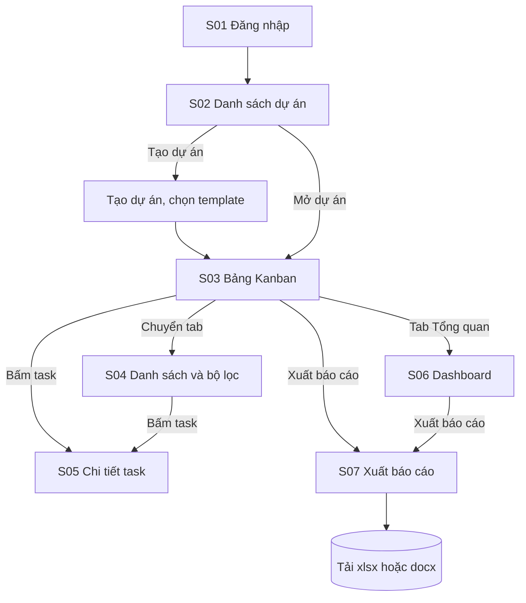
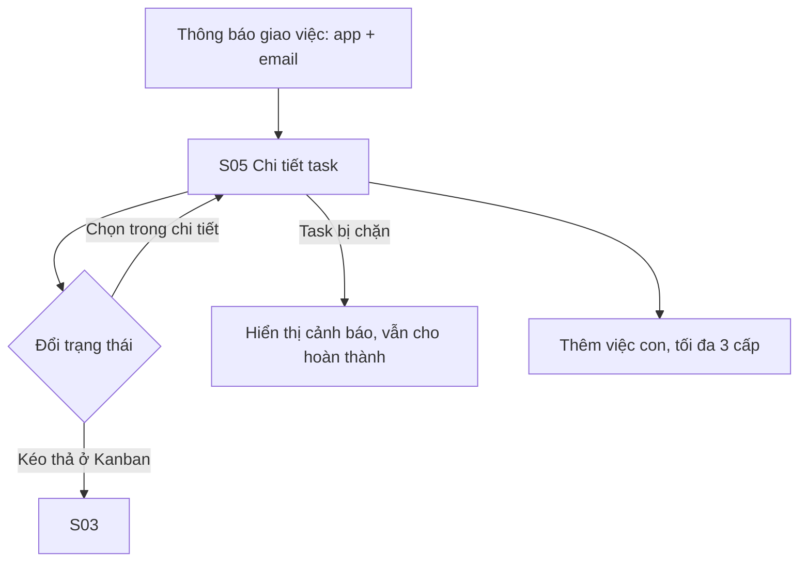
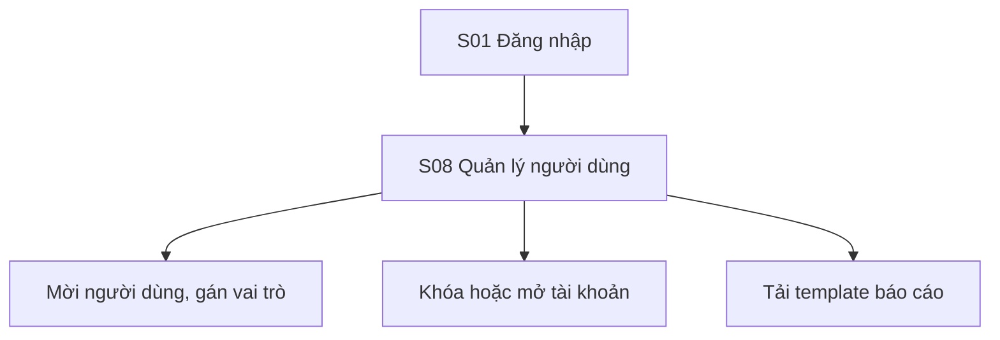

# User flow

Ngày: 2026-11-13 · Pha 3 · Liên quan: UC-01 đến UC-13, [screens.md](screens.md)

## 1. Luồng PM: từ dự án đến báo cáo

## 2. Luồng Thành viên: nhận việc và cập nhật

## 3. Luồng Admin

## 4. Luồng Người xem
Đăng nhập, mở dự án được mời, xem S03, S04, S06; mọi nút tạo, sửa, kéo thả, xuất báo cáo bị ẩn hoặc vô hiệu hóa (BR-02).

## 5. Luồng trên điện thoại
Từ S02 mở dự án, dùng S09: chọn cột bằng các nút ở đầu, mở menu "Chuyển đến cột" của thẻ thay cho kéo thả. Mọi vùng bấm từ 44 px.
